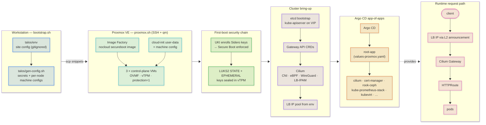

# talos-klube

Homelab Kubernetes on [Talos Linux](https://www.talos.dev), managed by an
[Argo CD](https://argo-cd.readthedocs.io) app-of-apps. Exploring how far a
fully free stack can go as an OpenShift (OCP) replacement.

Target platform: **Proxmox VE**, provisioned by `proxmox.sh`, with
**Cilium for everything** — CNI, kube-proxy replacement, WireGuard
encryption, LB-IPAM + L2 announcements, Gateway API, Hubble. (The
original vSphere/flannel/MetalLB/ingress-nginx generation is retired;
its scripts live on in git history.)

## The stack

- **Talos v1.14.4** — immutable, API-only OS; no SSH, no shell. Machine
  configs delivered via cloud-init (nocloud); STATE/EPHEMERAL partitions
  LUKS2-encrypted (keys sealed in the vTPM with the default `SECUREBOOT=1`,
  nodeID-keyed otherwise). 3 converged control-plane nodes with a
  shared VIP; workloads schedule on control planes.
- **Cilium 1.20** — kube-proxy-free (eBPF, via KubePrism `localhost:7445`),
  WireGuard pod+node encryption, `bpf.masquerade`, LB-IPAM +
  `CiliumL2AnnouncementPolicy` (replaces MetalLB), Gateway API v1.6
  (replaces the retired ingress-nginx), Hubble relay/UI.
- **Argo CD 3.5** (chart 10.11) — app-of-apps rooted at
  [app/charts/root-app](app/charts/root-app); per-cluster behavior via
  values overlays ([values-proxmox.yaml](app/charts/root-app/values-proxmox.yaml)).
- **kube-prometheus-stack**, **cert-manager 1.21**, **Rook-Ceph 1.21**
  (consumes each node's blank second disk; CSI drivers via the
  `ceph-csi-drivers` app — see [values.yaml](app/charts/root-app/values.yaml)).
- **KubeVirt 1.9 + CDI 1.66** — nested-virt VM workloads; see
  [the KubeVirt lab notes](docs/kubevirt-lab.md).

## Deployment flow



The full diagram, with more detail on each stage, is
[docs/deployment-flow.mmd](docs/deployment-flow.mmd)
(Mermaid: renders in VS Code/JetBrains, [mermaid.live](https://mermaid.live),
or `mmdc`). Day-to-day commands (talosctl, kubectl, Cilium/Argo/Rook, and
an `oc` translation table) live in
[docs/cli-cheatsheet.md](docs/cli-cheatsheet.md).

## Repo layout

```
proxmox.sh                  # provision Talos VMs on Proxmox (qm over SSH)
bootstrap.sh                # end-to-end: configs -> VMs -> Cilium -> Argo CD
talos/
  patches/cluster.yaml      # committed machine-config patch (no secrets)
  gen-config.sh             # renders per-node configs into talos/clusterconfig/ (gitignored)
app/
  bootstrap/                # per-cluster root Application manifests
  charts/root-app/          # app-of-apps: one Application template per component
  charts/cilium/            # Cilium wrapper chart + LB-IPAM/L2 policy
  charts/argo-cd/           # Argo CD wrapper chart
  charts/issuers/           # ClusterIssuers: internal CA (default), Venafi + ACME toggles
```

**Never commit:** `talos/secrets.yaml`, anything in `talos/clusterconfig/`,
`kubeconfig`, `talosconfig`, or rendered Helm output (embedded generated
CAs). All are gitignored — keep it that way.

## Deploying the Proxmox cluster

Prerequisites: `talosctl`, `kubectl`, `helm`, `curl`, and SSH key access to
the PVE node. DHCP is not used — pick static IPs on your VLAN.

```sh
# 1. fill in site config: SSH target, node IPs, VIP, GATEWAY/PREFIX, sizing,
#    and LB_START/LB_STOP (LoadBalancer IP range — applied at bootstrap and
#    deliberately never committed). talos/env is gitignored.
cp talos/env.example talos/env && $EDITOR talos/env
source talos/env
# 2. push to main — every Argo CD Application tracks `main` on GitHub,
#    not your working tree
# 3. run it:
./bootstrap.sh
```

`bootstrap.sh` generates fresh cluster secrets locally, provisions the VMs,
bootstraps etcd, installs Gateway API CRDs + Cilium + Argo CD, then applies
[root-app-proxmox.yaml](app/bootstrap/root-app-proxmox.yaml) — from there
Argo CD owns the cluster. Useful afterwards:

```sh
export TALOSCONFIG=$PWD/talos/clusterconfig/talosconfig KUBECONFIG=$PWD/kubeconfig
talosctl dashboard                                   # node health
kubectl -n kube-system exec ds/cilium -- cilium-dbg encrypt status   # WireGuard
kubectl -n kube-system port-forward svc/hubble-ui 12000:80           # flow map
```

Teardown: `./proxmox.sh destroy`

## Day-2 notes

- **Cilium ServiceMonitors** are on in
  [app/charts/cilium/values.yaml](app/charts/cilium/values.yaml).
  `bootstrap.sh` leaves them out of its pre-Argo render; the Argo `cilium`
  app retries until kube-prometheus-stack has installed their CRDs.
- **External Secrets:** the `ClusterSecretStore` pointing at OpenBao carries
  a site URL and auth, so it is applied by hand (`kubectl apply -f
  <your-store>.yaml`) after the `external-secrets` app is synced — never
  committed.
- **Expose services** with a `Gateway` + `HTTPRoute` (class `cilium`); the
  Gateway's Service gets an IP from the LB pool via L2 announcements.
  cert-manager can solve ACME via its Gateway API HTTP-01 solver.
- **Upgrades:** Renovate proposes chart/Talos bumps; `talosctl upgrade`
  one minor at a time for the OS.
- App toggles and chart versions live in
  [values.yaml](app/charts/root-app/values.yaml); per-cluster overlay
  files (e.g. `values-proxmox.yaml`) carry any divergence.

## KubeVirt lab

KubeVirt v1.9.1 and CDI v1.66.1 install as two more Argo Applications, each
vendoring its pinned upstream release manifest (`app/charts/vendor.sh`) with the
driving CR in sync wave 1. Together they turn the cluster into a nested-virt VM
platform — useful for anything that needs real VMs under Kubernetes.

The PVE host has `nested=1` and the VMs run `--cpu host`, so `/dev/kvm`,
`vhost-net` and `vhost-vsock` are all real inside the Talos guests: hardware
acceleration, not software emulation.

Three things the charts handle that a stock install would not: `ServerSideApply`
(the KubeVirt CRD sits at 91% of the client-side-apply annotation ceiling),
the privileged PSA label Talos needs that CDI's upstream namespace omits, and a
cluster eviction strategy that will not hang `talosctl upgrade` on a VM that
cannot migrate. All explained in
**[docs/kubevirt-lab.md](docs/kubevirt-lab.md)** · diagram
[docs/kubevirt-lab.mmd](docs/kubevirt-lab.mmd).

## Roadmap

The OCP-parity backlog lives in
[issues](https://github.com/skywalkw3r/talos-klube/issues) on the
[talos-klube project board](https://github.com/users/skywalkw3r/projects/1),
grouped under the [v1.1.0 milestone](https://github.com/skywalkw3r/talos-klube/milestone/1):
CI validation, Renovate, OIDC/SSO, SOPS-encrypted machine configs,
Terraform provisioning, Velero, Loki, Kyverno and Harbor. New ideas go in via
the feature request form; work branches from `dev`, PRs target `dev`, and
`dev` merges to `main` for a tagged release.

